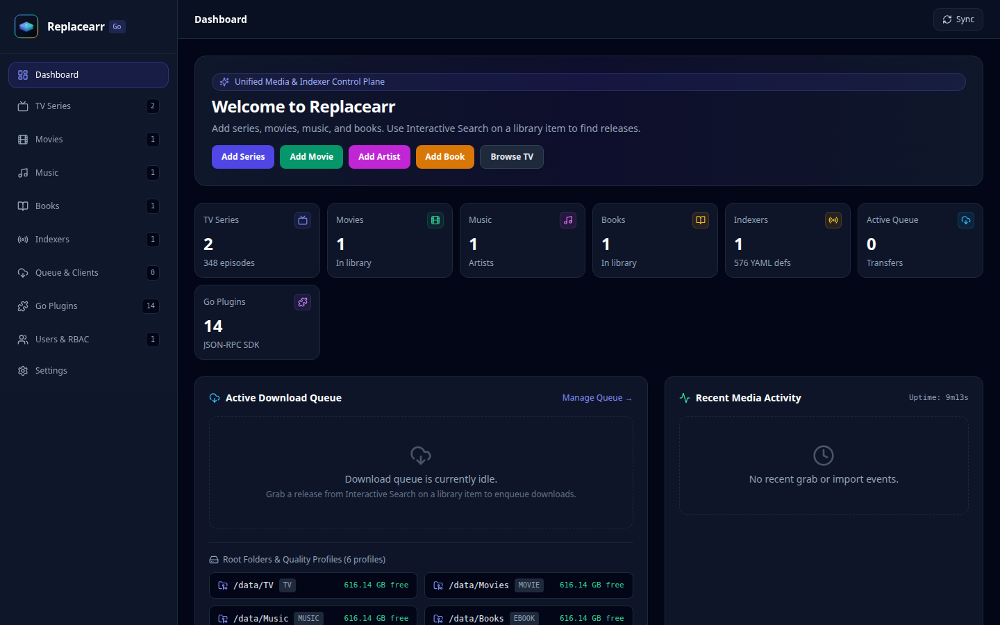

# Replacearr

Website: [replacearr.com](https://replacearr.com) · Source: [github.com/replacearr/replacearr](https://github.com/replacearr/replacearr) · Discord: [discord.gg/WUrKJuE5XB](https://discord.gg/WUrKJuE5XB)

This is a highly experimental AI created repo. I still have to deslop it. feel free to make PRs and issues. All are welcome. just needed it published so that I can deploy it using dockerhub.

**Replacearr** is a fast, single-binary, Go-powered replacement for **Sonarr**, **Radarr**, and **Prowlarr** with a unified React web interface, role-based access control (RBAC) for users and scoped API keys, native Cardigann YAML indexer definitions, and an out-of-process **Go Plugin SDK** (`pkg/pluginsdk`).

## Screenshots



- [Desktop gallery](images/desktop/README.md) (1440×900)
- [Mobile gallery](images/mobile/README.md) (390×844)
- [All screenshot assets](images/README.md)

---

## Key Features

- **Unified Media & Indexer Engine**: Manage TV series (Sonarr), Movies (Radarr), Indexers & Search (Prowlarr), Download Clients, Quality Profiles, Root Folders, Calendar, Activity Queue, and History in a single lightweight process and SQLite database.
- **Drop-In Upstream `*arr` API Compatibility**:
  - **Sonarr v3 API**: `/sonarr/api/v3/*` (and `/api/v3/*` auto-routed)
  - **Radarr v3 API**: `/radarr/api/v3/*` (and `/api/v3/*` auto-routed)
  - **Prowlarr v1 API**: `/prowlarr/api/v1/*` (and `/api/v1/*` auto-routed)
  - Connect Overseerr, Jellyseerr, Bazarr, Homepage, Tautulli, or mobile apps (LunaSea, nzb360) directly to Replacearr without changing client code.
- **Multi-User RBAC & Scoped API Keys**:
  - Built-in roles (`admin`, `manager`, `requester`, `viewer`, `integration`) and custom roles with granular permissions (`tv:read`, `tv:write`, `movies:write`, `indexers:search`, `plugins:manage`, `users:manage`, etc.).
  - Create API keys scoped to `all`, `sonarr`, `radarr`, or `prowlarr` with fine-grained permission subsets.
  - Supports JWT Bearer tokens (`Authorization: Bearer <token>`) as well as `*arr`-compatible `X-Api-Key` headers and `?apikey=` query parameters.
- **Go Plugin SDK (`pkg/pluginsdk`)**:
  - Extend Replacearr with custom indexers, download clients, or notification hooks written in standard Go.
  - Out-of-process JSON-RPC 2.0 over stdio isolation — plugins run as independent binaries in `/config/plugins` without requiring CGO or dynamic library version lock-in.
- **Cardigann YAML Definition Loader**:
  - Ships ~580 Cardigann YAML indexer definitions in repo `definitions/` (seeded into `REPLACEARR_DEFINITIONS_DIR`, default `/config/definitions`; built-in fallbacks when empty). Refresh with `make sync-definitions`.
- **Single Static Binary & LinuxServer-Style Docker Image**:
  - Pure-Go SQLite (`modernc.org/sqlite`), embedded React SPA (`internal/webui`), `CGO_ENABLED=0` static compilation, and a production multi-stage container supporting `PUID`/`PGID` and `TZ`.

---

## Architecture Overview

```text
replacearr/
├── cmd/replacearr/                # Main server entrypoint
├── examples/plugins/
│   └── sample-indexer/            # Host test fixture (shipped plugins: replacearr/replacearr-plugins)
├── internal/
│   ├── api/                       # Unified REST API + Sonarr/Radarr/Prowlarr compat routers
│   ├── auth/                      # Password hashing, JWT tokens, RBAC & API key middleware
│   ├── config/                    # Environment & file-backed runtime configuration
│   ├── db/                        # Pure-Go SQLite store, migrations & default seeders
│   ├── domain/                    # Core domain models & RBAC permission constants
│   ├── indexers/                  # Torznab/Newznab, Cardigann YAML & Plugin search engine
│   ├── plugincatalog/             # Marketplace registry.json fetch + checksummed install
│   ├── pluginhost/                # Out-of-process plugin host & JSON-RPC supervisor
│   └── webui/                     # Go embed.FS serving the compiled React SPA
├── pkg/pluginsdk/                 # Public Go SDK for authoring Replacearr plugins
├── web/                           # React + TypeScript + Vite unified frontend
├── docker/
│   ├── Dockerfile                 # Multi-stage production container image
│   ├── docker-compose.prod.yml    # End-user production Docker Compose stack
│   └── entrypoint.sh              # PUID/PGID setup & bundled plugin seeding
├── Dockerfile                     # Root Go+Node image for local containerized development
├── docker-compose.yml             # Local containerized development (bind-mount, /data paths)
├── entrypoint.sh                  # Local dev container entrypoint (Air + Vite)
├── .air.toml                      # Air live-reload config for the Go API
└── Makefile                       # Build, test, and Docker automation
```

---

## Upstream `*arr` Compatibility Endpoints

Replacearr exposes both a unified modern API (`/api/v1/*`) for its web UI and drop-in compatibility prefixes so external ecosystem tools can treat a single Replacearr instance as Sonarr, Radarr, and Prowlarr simultaneously:

| Ecosystem Service | Base URL Prefix | Supported Endpoints |
| :--- | :--- | :--- |
| **Sonarr v3** | `/sonarr/api/v3` | `/system/status`, `/series`, `/series/lookup`, `/episode`, `/qualityprofile`, `/rootfolder`, `/languageprofile`, `/tag`, `/queue`, `/calendar`, `/command`, `/downloadclient`, `/history` |
| **Radarr v3** | `/radarr/api/v3` | `/system/status`, `/movie`, `/movie/lookup`, `/qualityprofile`, `/rootfolder`, `/tag`, `/queue`, `/calendar`, `/command`, `/downloadclient`, `/history` |
| **Prowlarr v1** | `/prowlarr/api/v1` | `/system/status`, `/indexer`, `/indexer/schema`, `/search`, `/tag`, `/downloadclient`, `/health` |
| **Shared Root** | `/api/v3`, `/api/v1` | Direct root-level compatibility routes for `/api/v3/series`, `/api/v3/movie`, `/api/v1/indexer`, `/api/v1/search`, `/api` |

### Connecting Overseerr / Jellyseerr / Bazarr

1. In Replacearr, navigate to **Users & RBAC → API Keys**.
2. Create an API key with the **Integration** role (or custom permissions) and select a scope (`all`, `sonarr`, `radarr`, or `prowlarr`).
3. Configure your external tool:
   - **Sonarr URL**: `http://replacearr:8989/sonarr` (or `http://replacearr:8989` using root `/api/v3`)
   - **Radarr URL**: `http://replacearr:8989/radarr` (or `http://replacearr:8989` using root `/api/v3`)
   - **Prowlarr URL**: `http://replacearr:8989/prowlarr`

---

## Role-Based Access Control (RBAC) & Authentication

Replacearr supports multi-user accounts and scoped API keys out of the box.

### Built-In Roles

| Role | Description | Default Permissions |
| :--- | :--- | :--- |
| `admin` | Full administrative access | `*` (all permissions) |
| `manager` | Manage media, indexers, and downloads | `tv:*`, `movies:*`, `indexers:*`, `downloads:*`, `profiles:*`, `plugins:read`, `system:read` |
| `requester` | Add TV series/movies and search indexers | `tv:read`, `tv:write`, `movies:read`, `movies:write`, `indexers:read`, `indexers:search`, `downloads:read`, `profiles:read`, `system:read` |
| `viewer` | Read-only access to library and queue | `tv:read`, `movies:read`, `indexers:read`, `downloads:read`, `profiles:read`, `system:read` |
| `integration` | Service role for `*arr` apps | `tv:read`, `tv:write`, `movies:read`, `movies:write`, `indexers:read`, `indexers:search`, `downloads:read`, `downloads:write`, `profiles:read`, `system:read` |

### Permission Scopes

- **Media**: `tv:read`, `tv:write`, `tv:delete`, `movies:read`, `movies:write`, `movies:delete`
- **Indexers**: `indexers:read`, `indexers:write`, `indexers:search`
- **Downloads & Profiles**: `downloads:read`, `downloads:write`, `profiles:read`, `profiles:write`
- **Administration**: `plugins:read`, `plugins:manage`, `users:read`, `users:manage`, `system:read`, `system:manage`

---

## Go Plugin SDK (`pkg/pluginsdk`)

Replacearr features an extensible, out-of-process plugin system using JSON-RPC 2.0 over standard input/output. Anyone can write a plugin in pure Go without compiling against internal Replacearr packages or worrying about shared-library (`go plugin`) version mismatches.

### Writing a Custom Indexer Plugin

```go
package main

import (
	"context"
	"fmt"
	"time"

	"github.com/replacearr/replacearr/pkg/pluginsdk"
)

type CustomIndexer struct {
	settings map[string]any
}

func (p *CustomIndexer) Manifest() pluginsdk.Manifest {
	return pluginsdk.Manifest{
		ID:          "com.example.custom-indexer",
		Name:        "Custom Go Indexer",
		Version:     "1.0.0",
		Author:      "Your Name",
		Description: "Example custom indexer built with Replacearr Go Plugin SDK",
		Types:       []pluginsdk.PluginType{pluginsdk.PluginTypeIndexer},
		ConfigSchema: []pluginsdk.ConfigFieldSchema{
			{
				Name:     "baseUrl",
				Label:    "Tracker URL",
				Type:     "text",
				Default:  "https://tracker.example.com",
				Required: true,
			},
			{
				Name:     "apiKey",
				Label:    "API Key",
				Type:     "password",
				Required: false,
			},
		},
	}
}

func (p *CustomIndexer) Configure(settings map[string]any) error {
	p.settings = settings
	return nil
}

func (p *CustomIndexer) Search(_ context.Context, req pluginsdk.SearchRequest) ([]pluginsdk.Release, error) {
	query := req.Query
	if query == "" {
		query = "Latest"
	}
	return []pluginsdk.Release{
		{
			Guid:        fmt.Sprintf("custom-%d", time.Now().UnixNano()),
			Title:       fmt.Sprintf("%s.2026.1080p.WEB-DL.DDP5.1.H.264-REPLACEARR", query),
			Protocol:    "torrent",
			Size:        4_294_967_296,
			PublishDate: time.Now().UTC().Format(time.RFC3339),
			DownloadURL: "magnet:?xt=urn:btih:0123456789abcdef0123456789abcdef01234567",
			Seeders:     150,
			Peers:       165,
			Categories:  []int{2000, 5000},
			Quality:     "WEBDL-1080p",
		},
	}, nil
}

func main() {
	pluginsdk.Serve(&CustomIndexer{})
}
```

**Marketplace:** optional community/first-party plugins are listed from
[`replacearr/replacearr-plugins`](https://github.com/replacearr/replacearr-plugins)
`registry.json` (override with `REPLACEARR_PLUGIN_CATALOG_URL`). Use **Plugins → Marketplace**
to install checksummed release binaries into `REPLACEARR_PLUGIN_DIR`.

Or build a plugin yourself and place it in `/config/plugins` (or `bin/plugins` in development):

```bash
CGO_ENABLED=0 go build -ldflags="-s -w" -o /config/plugins/my-indexer ./cmd/my-indexer
```

Then click **Re-Scan Plugin Directory** in the **Plugins** tab.

---

## Docker Deployment

**Official image:** [`ldrrp/replacearr` on Docker Hub](https://hub.docker.com/r/ldrrp/replacearr)

```bash
docker pull ldrrp/replacearr:latest
```

### Production Deployment (`docker/docker-compose.prod.yml`)

Run Replacearr in production using the published image above, or build locally from the multi-stage container in `docker/`:

```bash
# Build and start the production container in the background
docker compose -f docker/docker-compose.prod.yml up -d --build
```

Example `docker-compose.yml` for end users:

```yaml
services:
  replacearr:
    image: ldrrp/replacearr:latest
    container_name: replacearr
    environment:
      - PUID=1000
      - PGID=1000
      - TZ=UTC
      - REPLACEARR_ADMIN_USER=admin
      - REPLACEARR_ADMIN_PASS=replacearr
    ports:
      - "8989:8989"
    volumes:
      - ./config:/config
      - ./media:/data
    restart: unless-stopped
```

### Environment Variables

| Variable | Default | Description |
| :--- | :--- | :--- |
| `PUID` | `1000` | User ID for file permissions inside the container |
| `PGID` | `1000` | Group ID for file permissions inside the container |
| `TZ` | `UTC` | Container timezone |
| `REPLACEARR_HOST` | `0.0.0.0` | HTTP bind address |
| `REPLACEARR_PORT` | `8989` | HTTP listen port |
| `REPLACEARR_CONFIG_DIR` | `/config` | Directory for SQLite database, JWT secret, and plugins |
| `REPLACEARR_DB_PATH` | `/config/replacearr.db` | Custom path to SQLite database file |
| `REPLACEARR_PLUGIN_DIR` | `/config/plugins` | Directory scanned for executable Go plugins |
| `REPLACEARR_PLUGIN_CATALOG_URL` | replacearr-plugins `registry.json` | Marketplace registry URL (HTTPS) |
| `REPLACEARR_DEFINITIONS_DIR` | `/config/definitions` | Directory scanned for Cardigann YAML definitions (seeded from bundled `definitions/`) |
| `REPLACEARR_ADMIN_USER` | `admin` | Initial admin username seeded on first startup |
| `REPLACEARR_ADMIN_PASS` | `replacearr` | Initial admin password seeded on first startup |
| `REPLACEARR_API_KEY` | *(auto-generated)* | Optional fixed default system API key |
| `REPLACEARR_JWT_SECRET` | *(auto-generated)* | Secret key used for signing JWT tokens |

---

## Development & Makefile Commands

### Prerequisites

- **Docker** & **Docker Compose** (required for local development via `make start`)
- **Go** `1.25+` (toolchain pinned to **1.27** in `go.mod` / Dockerfiles) and **Node.js** `24+` only if you run `make test` / `make build` on the host

### Quick Start (Local Development)

Local development is containerized so media paths match production (`/data/TV`, `/data/Movies`, `/data/downloads`):

```bash
make start               # API :8989 + Vite :5173 (root docker-compose.yml)
# UI http://localhost:5173  ·  API http://localhost:8989
make stop                # stop the stack (keeps ./config and ./data)

# Or build a single self-contained binary with embedded UI + plugins:
make build
./bin/replacearr
```

#### Live reload (Air)

The development container runs [Air](https://github.com/air-verse/air) for the Go API and Vite HMR for the UI:

- `make start` bind-mounts the repo at `/workspace` and starts Air via `entrypoint.sh` (config: `.air.toml`).
- Saving a `.go` or embedded `.sql` migration rebuilds and restarts **only** the Replacearr process inside the running container — the container itself stays up.
- Compile errors print in `docker compose logs -f replacearr`; Air keeps watching, so fixing the error triggers another build automatically.
- Frontend edits still use Vite HMR on `:5173` (no container restart).
- Production images (`docker/Dockerfile`) do **not** install Air.

**File watching / bind-mount troubleshooting**

| Symptom | What to try |
| :--- | :--- |
| Edits on the host do not rebuild | Confirm the compose volume `.:/workspace` is mounted (`docker compose exec replacearr ls /workspace/cmd`). `.air.toml` enables `poll = true` for bind mounts; rebuild the image if that file is missing (`make start`). |
| Rebuild is slow or flapping | Narrow watched paths in `.air.toml` `exclude_dir`; avoid writing under watched trees (`tmp/`, `bin/`, `web/`). |
| `air: command not found` | Rebuild the **development** image (`docker compose build --no-cache replacearr` then `make start`). Do not expect Air in the production image. |
| Stale binary after a failed compile | Check logs for the compile error; Air leaves the previous successful binary running until the next successful build (`stop_on_error = false`). |

### Makefile Targets Reference

| Command | Description |
| :--- | :--- |
| `make help` | Show all available `make` targets |
| `make build-web` | Build static React SPA and copy into `internal/webui/dist` |
| `make build-plugins` | Ensures `bin/plugins/` exists; optional plugins install from the marketplace |
| `make build-backend` | Compile the static `bin/replacearr` binary |
| `make build` | Full production build (React UI + plugins + static Go binary) |
| `make test` | Run all Go backend unit/integration tests and frontend typechecks |
| `make test-go` | Run `go test -v -race ./...` |
| `make test-web` | Run TypeScript verification (`npm run typecheck`) in `web/` |
| `make start` | Start containerized local dev with Air live reload + Vite (`docker-compose.yml`) |
| `make stop` | Stop the local containerized stack (keeps `./config` and `./data`) |
| `make build-docker` | Build the public production multi-stage Docker image (`docker/Dockerfile`) |
| `make clean` | Clean build artifacts, embedded dist files, and temporary dev config |
| `make clean-all` | Deep clean including `web/node_modules` |

---

## License

MIT
