# Mobile screenshots

Captured at 390×844 (phone viewport). API keys are redacted in these images.

## Sign in

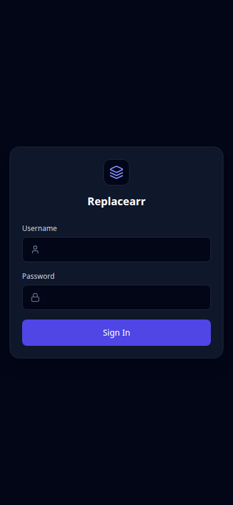

## Dashboard

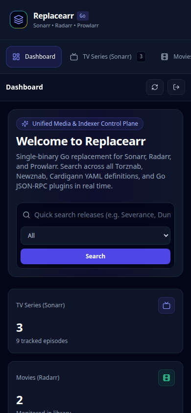

## TV series

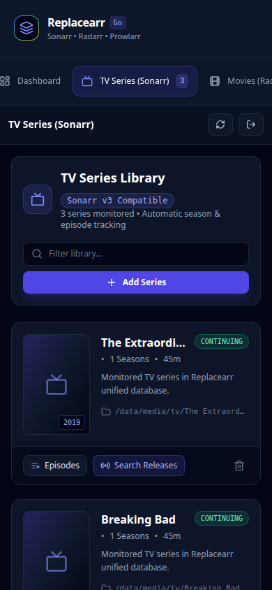

## Movies

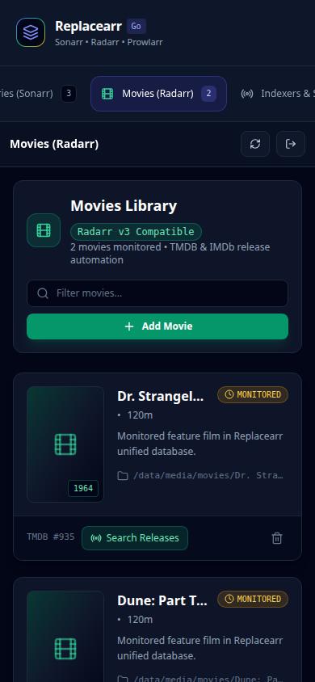

## Indexers and search

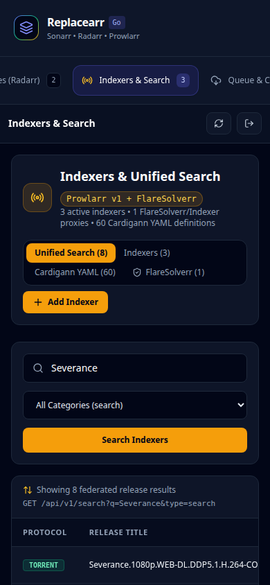

## Queue and download clients

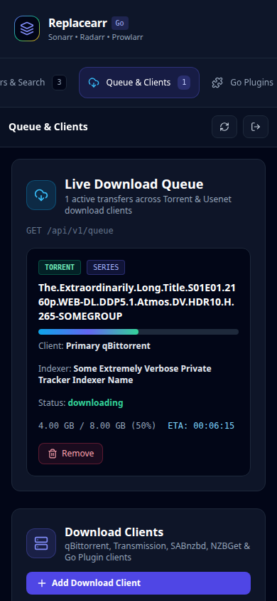

## Plugins

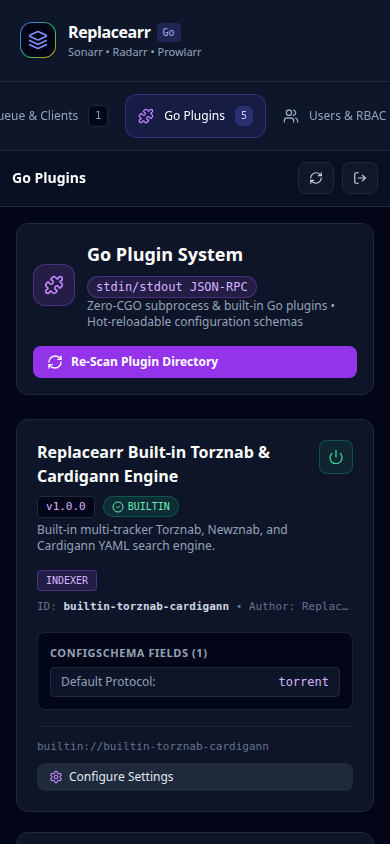

## Users and RBAC

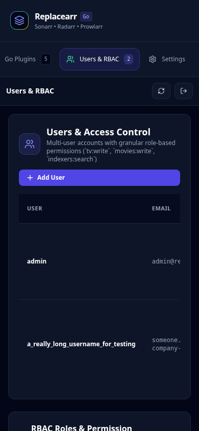

## Settings (home)

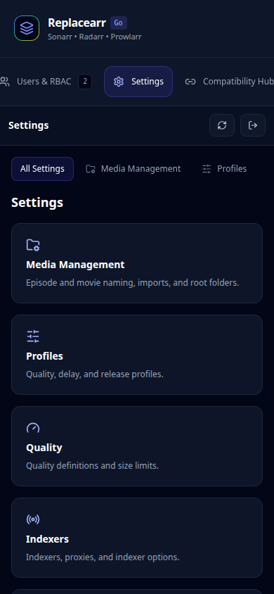

## Settings — General

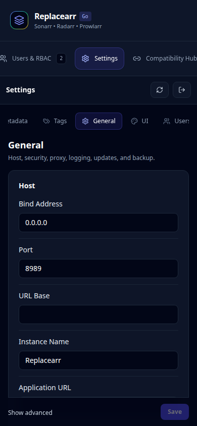

## Settings — UI

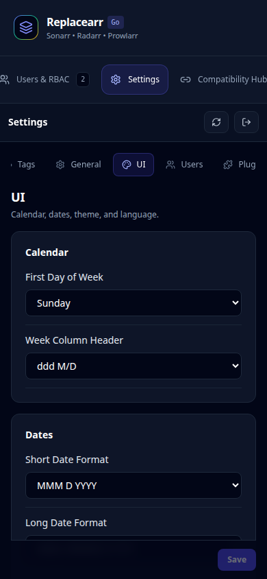

## Settings — Media management

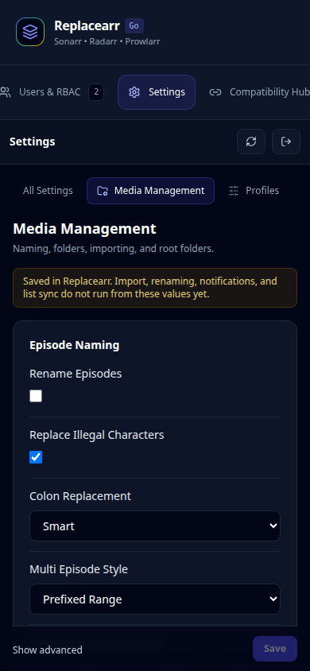

## Settings — Profiles

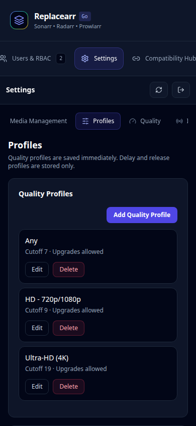

## Settings — Quality

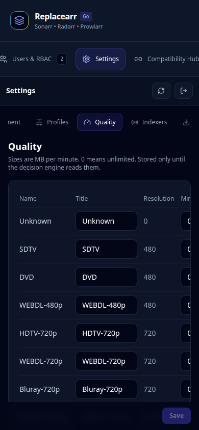

## Settings — Indexers

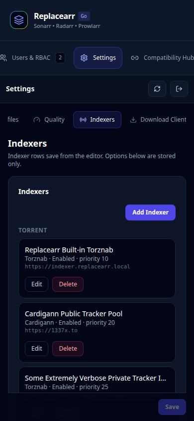

## Settings — Download clients

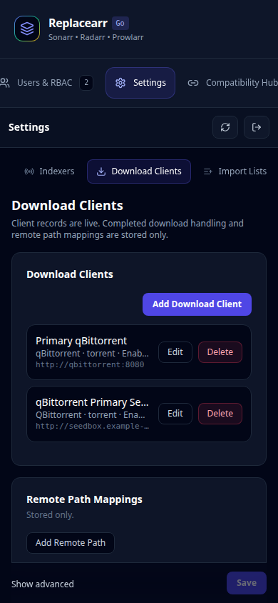

## Settings — Import lists

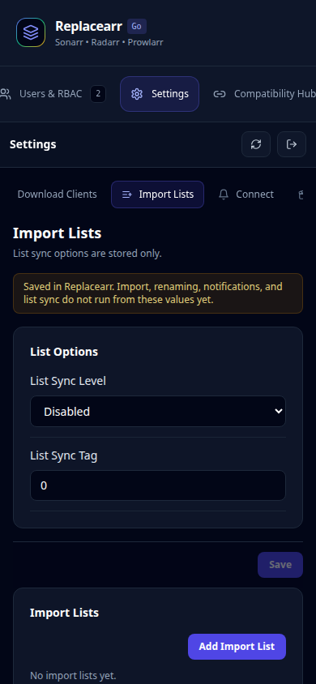

## Settings — Connect

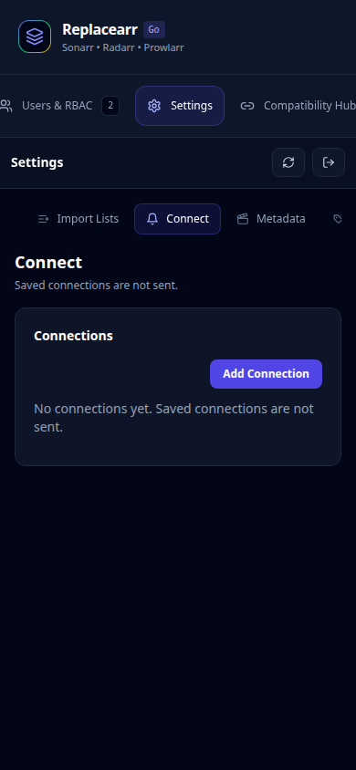

## Settings — Metadata

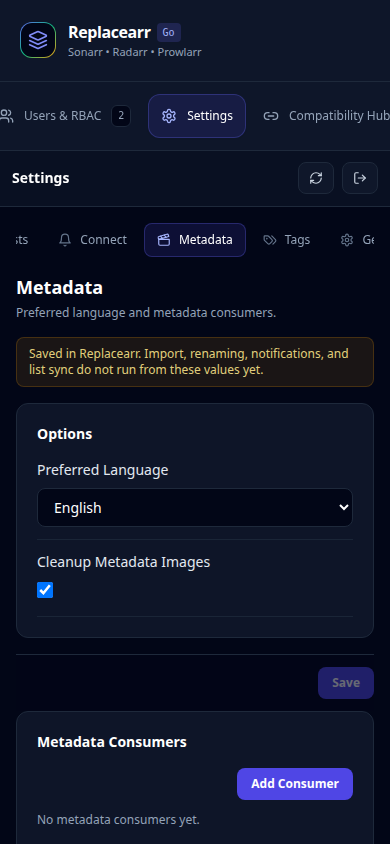

## Settings — Tags

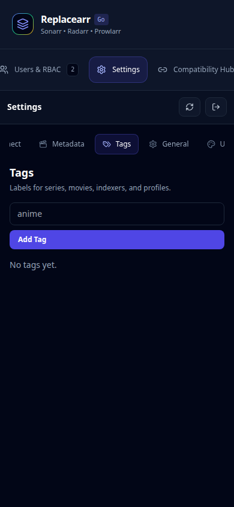

## Compatibility hub

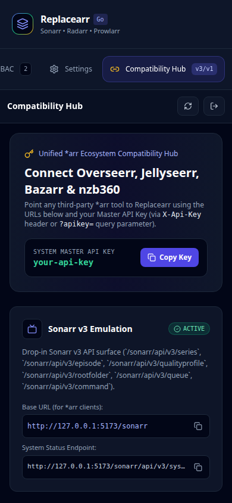
